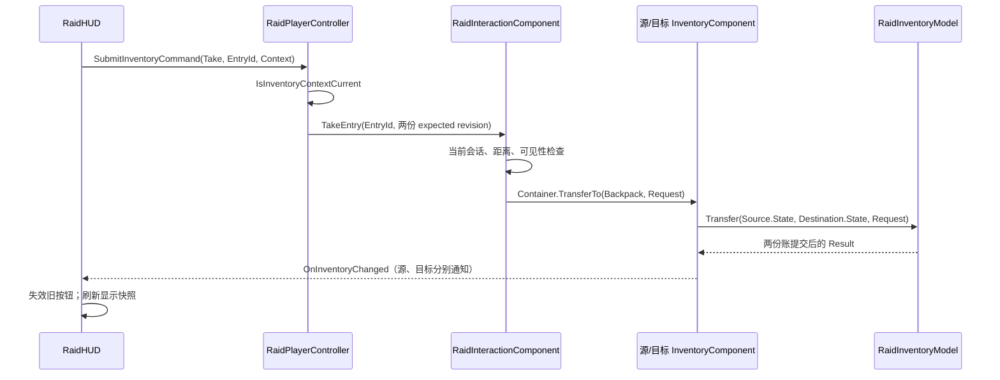

# R6 源码跟读：从一次取物理解 UE 客户端分层

这份导览面向刚开始读 C++／UE 源码的同学。读完后，应能沿着“点击取物 → 校验命令 → 更新两份库存 → 刷新 HUD”找到真正执行规则的位置，并说明换 Pawn、销毁容器时如何清理旧状态。

**阅读版本**：下面的源码链接对应已集成到 `Source/GreyzoneRaid` 的 R6 实现，以文件和函数名导航，避免后续小修使工程行号失效。引擎证据来自本机 `UE_5.8` 目录，`Build.version` 实际为 **5.8.3，Changelist 58210709**；升级引擎后应重新核对引擎行号。

这里说明实现和测试意图，**不把“有测试代码”写成“测试已通过”**。玩法／生命周期运行结果以 [TEST_RESULTS.md](TEST_RESULTS.md) 的对应 R6 记录为准；性能实验单独阅读 [R6_ENGINE_EXPERIMENT.md](R6_ENGINE_EXPERIMENT.md)，本文不承诺 FPS 提升。

跟读顺序：[职责地图](#1-先找职责再读实现) → [数据与身份](#2-区分物品定义条目身份和库存版本) → [一次取物](#3-沿着一次取物走完整条调用链) → [事务规则](#4-从失败路径理解事务和守恒) → [事件与界面](#5-只读视图事件广播与当前界面命令) → [引擎生命周期](#6-在本机引擎源码里确认组件生命周期) → [引用与换人](#7-对象引用换-pawn-与-endplay-清理) → [实现边界](#8-这次拆分解决什么保留什么) → [面试自测](#9-用代码回答八个面试问题)。

## 1. 先找职责，再读实现

第一次不要从几万字节的 `RaidPlayer.cpp` 顶部读到底。先打开头文件看“能做什么”，再按表中的函数名跳进 `.cpp` 看“怎样做”。

| 入口 | 应当负责的事情 | 优先搜索的符号 |
| --- | --- | --- |
| [RaidInventoryTypes.h](Source/GreyzoneRaid/RaidInventoryTypes.h) | 定义、种子、运行时条目、命令与结果这些数据形状 | `FRaidItemDefinition`、`FRaidInventoryEntry`、`FRaidTransferRequest` |
| [RaidInventoryModel.h](Source/GreyzoneRaid/RaidInventoryModel.h) / [.cpp](Source/GreyzoneRaid/RaidInventoryModel.cpp) | 不依赖 Actor／World 的校验、数量计算和状态提交 | `ValidateState`、`CheckRevision`、`Transfer` |
| [RaidInventoryComponent.h](Source/GreyzoneRaid/RaidInventoryComponent.h) / [.cpp](Source/GreyzoneRaid/RaidInventoryComponent.cpp) | 持有唯一可变库存、控制写入、提交后通知观察者 | 私有 `State`、`TransferTo`、`ConsumeWithCommit` |
| [RaidItemCatalog.h](Source/GreyzoneRaid/RaidItemCatalog.h) / [.cpp](Source/GreyzoneRaid/RaidItemCatalog.cpp) | 从资产定义解析物品行为；拒绝未知／重复 ID | `Validate`、`ResolveLegacy` |
| [RaidInteractionComponent.h](Source/GreyzoneRaid/RaidInteractionComponent.h) / [.cpp](Source/GreyzoneRaid/RaidInteractionComponent.cpp) | 当前打开哪个箱子、可达性、搜索计时、取／放／使用意图 | `Open`、`CompleteSearch`、`TakeEntry`、`UseEntry`、`Cleanup` |
| [RaidPlayerController.h](Source/GreyzoneRaid/RaidPlayerController.h) / [.cpp](Source/GreyzoneRaid/RaidPlayerController.cpp) | 当前控制哪个 Pawn、输入模式、验证 UI 命令上下文 | `OnPossess`、`ReleasePawn`、`SubmitInventoryCommand` |
| [RaidHUD.h](Source/GreyzoneRaid/RaidHUD.h) / [.cpp](Source/GreyzoneRaid/RaidHUD.cpp) | 绘制 Canvas、维护显示快照、把点击转换成明确命令 | `RefreshBackpackView`、`RegisterInventoryCommand`、`NotifyHitBoxClick` |
| [RaidPlayer.h](Source/GreyzoneRaid/RaidPlayer.h) / [.cpp](Source/GreyzoneRaid/RaidPlayer.cpp) | Character 移动／武器／生命值；创建组件；保留兼容入口 | 构造函数、`BeginPlay`、`SetupPlayerInputComponent`、`StopInteractionForUnpossess` |
| [RaidLoot.h](Source/GreyzoneRaid/RaidLoot.h) / [.cpp](Source/GreyzoneRaid/RaidLoot.cpp) | 箱子的世界表现和旧地图数据导入；库存交给组件 | `EnsureContents`、`GetContents`、`GetRevision` |

记住三层区别：**Model 决定账能不能改，Component 持有账并通知，Interaction 决定这次玩家操作是否允许发生。** Controller 和 HUD 不应自己扣数量。

`ARaidPlayer::TakeLootItem(Index)` 等旧入口仍可存在，但只是把当前数组下标转换为 `EntryId`，再转交组件的薄门面。它们不再拥有第二套 `Inventory`、`LootCount` 或 `TotalLootValue` 状态。这样已有导演测试和调用点可以逐步迁移，又不会留下两套需要手动同步的账本。

## 2. 区分物品定义、条目身份和库存版本

打开 [RaidInventoryTypes.h](Source/GreyzoneRaid/RaidInventoryTypes.h)，先弄清下面四种数据。

| 类型／字段 | 含义 | 容易混淆的地方 |
| --- | --- | --- |
| `FRaidItemDefinition` | `ItemId`、显示名、单价、`UseEffect`、`UseAmount` | 物品类别和使用效果，不是库存里的某一行 |
| `FRaidInventorySeed` | 初始化时导入的定义、数量、是否已揭示 | 没有运行时 ID／revision，不能拿存档下标冒充有效命令 |
| `FRaidInventoryEntry::EntryId` | 这份库存中的稳定条目身份 | 不是数组下标，也不是跨所有库存唯一的 ID |
| `Revision` | 这份库存成功改变后的版本号 | 不是物品身份；同一个条目数量变化时 ID 不变、版本会变 |

例如背包数组现在是 `[EntryId=11, EntryId=12]`。消耗掉第一行后，第二行可以移动到下标 `0`，但其 `EntryId` 仍是 `12`。未来新增条目也不能复用已删除的 `11`。这正是 [Model 的 `CommitKnownAddition` 与 `Consume`](Source/GreyzoneRaid/RaidInventoryModel.cpp) 中 `NextEntryId` 单调增长和数组压缩要一起阅读的原因。

只有 ID 仍不够：箱子 A 和箱子 B 都可能拥有 `EntryId=1`。因此 UI 命令同时携带 [FRaidInventoryCommandContext](Source/GreyzoneRaid/RaidPlayerController.h) 中的 Player、容器和两个库存组件身份，以及 **SessionRevision、BackpackRevision、ContainerRevision**。它回答的是“在谁的哪一次交互会话、哪份库存版本上，对哪个条目做什么”。

再看 [RaidItemCatalog.cpp 的 `ResolveLegacy`](Source/GreyzoneRaid/RaidItemCatalog.cpp)：使用效果来自 catalog；旧 R5 地图里的显示名和价格变体仍保留。相同 `ItemId` 不代表一定能堆叠：当前堆叠键包括 ID、显示名和单价，效果与效果量还必须相容。未知物品明确失败，不根据字符串猜测它是不是医疗包。

箱子的 [EnsureContents](Source/GreyzoneRaid/RaidLoot.cpp) 把旧地图 `Contents` 转成已解析的种子，成功调用 `InitializeOnce` 后清空旧数组。之后 `GetContents()` 读取库存组件，旧 authoring 数组不再是另一份运行时账本。测试需要未知物品时，可在 deferred spawn 完成前注入明确的 `FRaidInventorySeed`；不必为了测试 ID 扩大生产 catalog，也不能在 BeginPlay 后修改旧 `Contents` 来冒充库存命令。

## 3. 沿着一次取物走完整条调用链

前提是已打开可访问的容器，目标行已搜索揭示，背包还有容量。读代码时可以依次给下列函数打断点；不需要先理解整套 Canvas 绘图。

1. [HUD 的 `DrawInventory` / `RegisterInventoryCommand`](Source/GreyzoneRaid/RaidHUD.cpp) 用当前显示条目创建命令映射。`Take_0` 是本次界面的按钮名，映射中的 `FRaidHUDInventoryAction.EntryId` 才是实际条目 ID；绘制时同时保存 `RenderedContext`。
2. `NotifyHitBoxClick` 确认按钮仍有效、上下文仍当前，**先复制命令及 Context，再清除当前按钮映射**。这是因为接下来的同步委托可能立刻刷新 HUD，不能继续依赖 map 中元素的指针。
3. [Controller 的 `SubmitInventoryCommand`](Source/GreyzoneRaid/RaidPlayerController.cpp) 再验证当前 Pawn、游戏状态、打开状态、组件身份和三个 revision，然后把 `Take` 交给 Interaction。测试直接调用这个接口，也会走相同校验。
4. [Interaction 的 `TakeEntry`](Source/GreyzoneRaid/RaidInteractionComponent.cpp) 检查真实世界可达性，构造 `FRaidTransferRequest`，把箱子设为 Source、背包设为 Destination。标签先复制出来，避免之后数组变化使旧条目引用失效。
5. [Component 的 `TransferTo`](Source/GreyzoneRaid/RaidInventoryComponent.cpp) 检查两个组件的写入状态并保护它们；[Model 的 `Transfer`](Source/GreyzoneRaid/RaidInventoryModel.cpp) 完成全部校验后，增加目标数量、扣除源数量、推进双方 revision。
6. 只有成功提交才广播。HUD 的 `HandleInventoryChanged` 清掉旧点击目标并重新复制视图；下一次 `DrawHUD` 再绘制。Interaction 成功后调用 Player 的 `RecordLootReceipt` 显示反馈，反馈函数不再负责加物品。

搜索和取物是两件事。沿 `BeginSearch → CompleteSearch → Inventory.Reveal` 可以看到搜索只改变“是否已知”；它不会顺便 Grant 到背包。搜索保存的是条目 ID 和版本，`GetSearchIndex()` 只是供兼容显示／测试使用的当前行号。

## 4. 从失败路径理解事务和守恒

先读 [Model 的 `Transfer`](Source/GreyzoneRaid/RaidInventoryModel.cpp) 上半段的返回条件，再看最后的提交段。它不是先 `Grant` 目标、再尝试 `Consume` 源；那样第二步失败时会凭空多出物品。

设源条目有 5 件，目标只剩 2 格，请求转移 3 件，且其他校验均满足：

| 策略 | 结果 | 源数量变化 | 目标数量变化 |
| --- | --- | --- | --- |
| `Exact` | `InsufficientCapacity` | 0 | 0 |
| `UpToCapacity` | 成功，`Result.Quantity=2` | −2 | +2 |

`UpToCapacity` 的实际数量是 `min(请求数量, 源可用数量, 目标剩余容量)`；结果为 0 时仍是失败。调用者应读取结果中的实际数量。成功转移保持定义和单价，因此两份库存的总数量、总物品价值守恒；失败则不应改变任意一方的条目、ID 分配状态或 revision。**使用物品**属于消费，会减少库存数量，不适用“转移守恒”。

跟读时检查这些分支是否都在首次写入之前：源／目标 revision、同库存转移、隐藏条目、数量与容量、相容堆叠、整数和 ID／revision 上界。价值用 `int64` 计算；给总量换一个更宽的类型，不代表可以省略上界检查。

容器设置 `bKeepEmptyRows=true` 时，取空的行仍保留身份；背包通常压缩空行。把已知物品放回箱子时，Model 不把它合并进尚未揭示的同类行，避免顺便揭露未知物品。这些都是规则，不是绘图层的特殊处理。

对应的代码级验证入口是 [RaidFrameworkTestDirector.cpp](Source/GreyzoneRaid/RaidFrameworkTestDirector.cpp) 的 `RunKernelCases`：搜索 `partial_transfer_moves_only_free_capacity_and_conserves_quantity_and_value`、`duplicate_successful_command_is_rejected_without_a_second_transfer` 和 `backpack_compaction_never_reuses_or_retargets_an_old_entry_handle`。这些断言说明要验证什么；实际 PASS 仍要看运行日志。

## 5. 只读视图、事件广播与当前界面命令

[InventoryComponent 的 `State` 是私有成员](Source/GreyzoneRaid/RaidInventoryComponent.h)，`GetEntries()` 返回 `const TArray<FRaidInventoryEntry>&`。外部可以读，不能通过这个接口增删行或改数量。`BlueprintReadOnly` 限制的是蓝图写入；C++ 封装仍依赖私有状态和 const 接口。

const 引用并不等于不可变化的历史快照。下一次成功命令可能让数组扩容或压缩，使保存的行指针／引用失效。HUD 因而在 [RefreshBackpackView / RefreshContainerView](Source/GreyzoneRaid/RaidHUD.cpp) 中复制条目，连同 revision 一起形成自己的显示快照；跨命令保存的是 `EntryId` 和 Context，不是 `&Entries[Index]`。

[Component 的 `TransferTo`](Source/GreyzoneRaid/RaidInventoryComponent.cpp) 用两个 `TGuardValue<bool>`，让源和目标从提交开始到两次通知结束都处于写保护状态。观察者第一次收到通知时，两边的账已经改完；若观察者同步回调中再次 Grant／Consume／Transfer，会收到 `Busy`。作用域退出时 guard 恢复旧值。这是**游戏线程上的同步重入保护，不是跨线程互斥锁**；当前实现没有承诺可以从工作线程同时调用库存 API。

使用医疗包／弹药还要读 `ConsumeWithCommit`：Interaction 先验证并算好新 Health／ReserveAmmo；组件消费成功后执行一个不失败、不广播的效果提交函数，然后才通知库存观察者。这样观察者不会看到“道具已扣，生命值还没加”的中间状态。失败消费不能重复执行效果。

界面安全分两层：

- 库存／会话事件到达时立即调用 `InvalidateInventoryButtons`；重绘前的旧按钮不能继续提交。
- 重绘后会生成新的命令映射；Controller 仍校验随命令保存的 Context。换 Pawn、换箱子、关闭再打开、任意一方库存变化，都可能使旧 Context 失效。

**固定 Canvas 名称是实时事件，不是可持久保存的命令。** 延迟之后再次发送字符串 `Take_0`，表达的是“点击现在叫这个名字的按钮”，不能声称它仍指向旧那一行。真正需要排队／延迟／重放的应用命令必须保存 `Command + EntryId + Context`，随后经过 `SubmitInventoryCommand` 校验。当前界面可以保留固定 hitbox 名，不必把所有名字改成全局唯一标识。

## 6. 在本机引擎源码里确认组件生命周期

Player 构造函数创建 `Backpack` 和 `Interaction` 默认子对象，见 [RaidPlayer.cpp](Source/GreyzoneRaid/RaidPlayer.cpp)。`CreateDefaultSubobject` 创建的是 UE 对象体系里的默认子对象，不能理解为普通 C++ `new` 后手动 `delete`。

下面是本机 **UE 5.8.3 / CL 58210709** 中已经逐行查看的入口。只列与本工程有关的主线；编辑器重建、蓝图 SCS、网络延迟 BeginPlay 等分支仍以源文件为准。

| 要验证的问题 | 真实源码入口及证据 |
| --- | --- |
| 默认子对象为什么在构造阶段创建？ | [UObjectGlobals.cpp:5844](<C:/Program Files/Epic Games/UE_5.8/Engine/Source/Runtime/CoreUObject/Private/UObject/UObjectGlobals.cpp:5844>)：`FObjectInitializer::CreateDefaultSubobject` 检查 `IsInConstructor`；5870 行设置 `RF_DefaultSubObject`。 |
| Actor 的默认组件谁来注册？ | [Actor.cpp:4327](<C:/Program Files/Epic Games/UE_5.8/Engine/Source/Runtime/Engine/Private/Actor.cpp:4327>)：`PostSpawnInitialize` 分发组件创建通知，并在不需要延迟注册时调用 `RegisterAllComponents`。没有原生 Scene Root 的蓝图分支可能延迟，不能概括成所有 Actor 都在同一行立即注册。 |
| 注册真正落到哪里？ | [Actor.cpp:5996](<C:/Program Files/Epic Games/UE_5.8/Engine/Source/Runtime/Engine/Private/Actor.cpp:5996>) 调用 `IncrementalRegisterComponents(0)`；[Actor.cpp:6235](<C:/Program Files/Epic Games/UE_5.8/Engine/Source/Runtime/Engine/Private/Actor.cpp:6235>) 检查有效、未注册、`bAutoRegister`，随后在 6262 行调用 `RegisterComponentWithWorld`。 |
| `InitializeComponent` 是否无条件发生？ | [Actor.cpp:6388](<C:/Program Files/Epic Games/UE_5.8/Engine/Source/Runtime/Engine/Private/Actor.cpp:6388>)：仅对已注册组件处理；初始化还要求 `bWantsInitializeComponent` 且尚未初始化。 |
| Actor 的 BeginPlay 怎样到达组件？ | [Actor.cpp:4808](<C:/Program Files/Epic Games/UE_5.8/Engine/Source/Runtime/Engine/Private/Actor.cpp:4808>) 遍历已注册且尚未 BeginPlay 的组件，先注册 tick 函数，再调用组件 `BeginPlay`。不要把不同 Actor 的 BeginPlay 当成任意依赖都已就绪的全局屏障。 |
| 运行中动态添加的组件怎么办？ | [ActorComponent.cpp:2079](<C:/Program Files/Epic Games/UE_5.8/Engine/Source/Runtime/Engine/Private/Components/ActorComponent.cpp:2079>)：`RegisterComponent` 取得 Owner 的 World，再调用 `RegisterComponentWithWorld`；后者在 [1967 行](<C:/Program Files/Epic Games/UE_5.8/Engine/Source/Runtime/Engine/Private/Components/ActorComponent.cpp:1967>) 开始检查并注册，2051 行通知 Owner。Owner 在 [Actor.cpp:6427](<C:/Program Files/Epic Games/UE_5.8/Engine/Source/Runtime/Engine/Private/Actor.cpp:6427>) 按初始化／BeginPlay 状态补齐生命周期。 |
| Actor 结束时组件如何收到通知？ | [Actor.cpp:3221](<C:/Program Files/Epic Games/UE_5.8/Engine/Source/Runtime/Engine/Private/Actor.cpp:3221>) 的 `RouteEndPlay` 调用 Actor `EndPlay`；[3259 行](<C:/Program Files/Epic Games/UE_5.8/Engine/Source/Runtime/Engine/Private/Actor.cpp:3259>) 的基类实现会把 EndPlay 传给已 BeginPlay 的组件。重写时遗漏 `Super::EndPlay` 会破坏这条链。 |

对应到本项目，应区分三个动作：

1. `CreateDefaultSubobject`：构造 Player 的默认组件，由 Actor 生命周期负责后续注册。
2. `UActorComponent::InitializeComponent / BeginPlay`：引擎生命周期入口。
3. **`URaidInventoryComponent::InitializeOnce`：我们自己定义的库存业务命令**，用于导入种子、确定容量、建立第一版库存。它不是引擎自动调用的同名钩子；Player 的 `BeginPlay` 显式调用它。

动态组件的实际示例就在 [FrameworkTestDirector 的 `SpawnInventory`](Source/GreyzoneRaid/RaidFrameworkTestDirector.cpp)：`SpawnActor → NewObject<URaidInventoryComponent>(Owner) → AddInstanceComponent → RegisterComponent`。这里需要真实注册，因为测试要验证世界中的 BeginPlay／EndPlay 与委托。纯 Model 测试只有值对象，不需要 World；一般的 `UObject`／DataAsset 也没有组件的 `RegisterComponent` 步骤。

本机文件哈希、版本及符号行号见 [R6LifecycleEngineEvidence.json](Evidence/R6LifecycleEngineEvidence.json)。它是源码查阅证据，不是引擎运行测试结果。

## 7. 对象引用、换 Pawn 与 EndPlay 清理

在 [RaidPlayer.h](Source/GreyzoneRaid/RaidPlayer.h) 找到 `UPROPERTY() TObjectPtr<URaidInventoryComponent>`、`TObjectPtr<URaidInteractionComponent>` 和加载后的 catalog 引用。它们表达 Player 的持有关系，并通过反射属性进入 GC 引用图。`TObjectPtr` 不是 `std::shared_ptr`；仅在栈上写一个 `TObjectPtr`，不能据此声称对象永远不会被回收。

这不是靠记忆判断：本机 [ObjectPtr.h:506](<C:/Program Files/Epic Games/UE_5.8/Engine/Source/Runtime/CoreUObject/Public/UObject/ObjectPtr.h:506>) 说明其 UObject 指针／序列化／GC 语义；[GarbageCollection.cpp:6837](<C:/Program Files/Epic Games/UE_5.8/Engine/Source/Runtime/CoreUObject/Private/UObject/GarbageCollection.cpp:6837>) 的 `FObjectProperty::EmitReferenceInfo` 把对象属性加入 GC 的 Reference schema。这里的强引用关系来自可达 UObject 上被 GC 跟踪的属性，不能把 `Outer` 或“有个 C++ 指针”单独当成通用保活保证。

HUD、Controller 和 Interaction 对“正在观察的 Pawn／箱子／组件”使用 `TWeakObjectPtr`。它表达可失效的观察关系，不延长对方生命周期；本机 [WeakObjectPtr.h:40](<C:/Program Files/Epic Games/UE_5.8/Engine/Source/Runtime/CoreUObject/Public/UObject/WeakObjectPtr.h:40>) 明确说明弱指针对对象是否被 GC 没有影响。每次使用仍需 `Get()`／`IsValid()`，遇到失效对象要停止操作。

弱指针不能替代业务清理。**EndPlay 是结束参与世界的通知，不等于 C++ 析构或内存已被 GC 回收**；即使对象暂时仍能读取，也不该接受新的库存写入。因此：

- [InventoryComponent::EndPlay](Source/GreyzoneRaid/RaidInventoryComponent.cpp) 先设置 `bEndingPlay`，再广播 EndingPlay，最后清理委托；回调可读取最终库存，修改则得到 `EndingPlay`。
- [Interaction::Close / Cleanup / EndPlay](Source/GreyzoneRaid/RaidInteractionComponent.cpp) 清搜索 timer、解除容器和背包观察、重置弱引用与会话状态、停用 tick。搜索完成回调在 Reveal 的同步广播之后还要检查会话是否被关闭／替换。
- [Controller::ReleasePawn](Source/GreyzoneRaid/RaidPlayerController.cpp) 让 HUD 取消观察，移除所保存的 `FDelegateHandle`，清旧 Pawn 引用，再按需要调用旧 Pawn 的 `StopInteractionForUnpossess`。这是解绑，不是销毁 Pawn。
- [HUD::UnbindObservedPlayer](Source/GreyzoneRaid/RaidHUD.cpp) 清委托、快照、反馈状态、revision 和按钮；新 Pawn 绑定时重新取得组件和显示视图。

核对 possession 的引擎路径：本机 [Controller.cpp:320](<C:/Program Files/Epic Games/UE_5.8/Engine/Source/Runtime/Engine/Private/Controller.cpp:320>) 的 `Possess` 调用虚函数 `OnPossess`；[PlayerController.cpp:873](<C:/Program Files/Epic Games/UE_5.8/Engine/Source/Runtime/Engine/Private/PlayerController.cpp:873>) 在更换 Pawn 时先 `UnPossess`，随后 `PossessedBy` 和 `SetPawn`。解除控制由 [Controller.cpp:386](<C:/Program Files/Epic Games/UE_5.8/Engine/Source/Runtime/Engine/Private/Controller.cpp:386>) 进入 `OnUnPossess`；[PlayerController.cpp:1353](<C:/Program Files/Epic Games/UE_5.8/Engine/Source/Runtime/Engine/Private/PlayerController.cpp:1353>) 通知 Pawn 并清空当前 Pawn。

因此本项目的 `OnPossess` 先调用 Super，再观察最终 `GetPawn()`；`OnUnPossess` 在 Super 清空 Pawn 前释放自己的订阅和动作。`BeginPlay` 再做一次安全绑定，处理 HUD 创建晚于 possession 的情况。不要把“在 BeginPlay 取一次 Player 指针”当成终身有效的绑定。

对应的 [FrameworkTestDirector::Tick](Source/GreyzoneRaid/RaidFrameworkTestDirector.cpp) 安排真实 `UnPossess`、替换 Pawn、销毁容器和等待旧搜索截止时间的流程。可搜索 `old_living_pawn_inventory_events_no_longer_refresh_new_pawn_HUD` 与 `old_destroyed_search_deadline_cannot_reveal_new_container_matching_handle`：前者检查还活着的旧 Pawn 是否已解绑，后者让新容器出现同号条目，检查旧搜索是否误作用到它。这样的夹具比只检查一个指针为空更能覆盖生命周期错误；是否通过仍以该次运行证据为准。

## 8. 这次拆分解决什么，保留什么

输入归属可以直接从两处 `SetupInputComponent` 对照：Controller 接收 Interact、Inventory、Heal、Restart、Quit；Character 继续处理移动、视角、开火、瞄准、换弹和冲刺。后者依赖 CharacterMovement、相机、武器表现和本 Pawn 的弹药／生命值，当前仍放在 Character 有清楚的依赖边界。未来出现多个独立武器实例时，再讨论武器组件或装备对象；文件变长本身不是继续拆类的充分理由。

Canvas 可以保留。R6 改的是数据流、命令验证和生命周期，已经存在的中文字体、分页布局、hitbox 及截图覆盖不需要因此整套重写。库存变化时刷新派生快照，绘制时使用快照；搜索进度、血量、瞄准等动态表现仍可实时读／绘制。**事件驱动库存不等于整个 HUD 不再每帧执行。**

`CountMedkits` 现在读取绑定／库存事件更新的缓存，并以 `Definition.UseEffect == Heal` 累加数量；旧代码按 `ItemId == Medkit` 每次扫描。这里同时有查询方式和物品判定语义的变化，不能把结果讲成“相同循环的语法优化”。创建快照和刷新缓存仍有成本。`FindExtraction` 的选择逻辑也应按源码和独立实验解释，不在这篇导览中编造速度结论。测量口径见 [R6_ENGINE_EXPERIMENT.md](R6_ENGINE_EXPERIMENT.md)。

目前的状态寿命跟随 Pawn、箱子和本局 World。没有跨关卡永久背包需求，就没有必要为了展示框架名词，把库存放进 `GameInstanceSubsystem`。当前明确的 Heal／Ammo 规则也无需为了两个效果引入完整 GAS。以后若加入跨局存档、复杂技能关系或多人同步，应重新论证这些系统的价值。

**这是单机实现。** 当前库存 API、Context 和 revision 不等于网络复制、RPC 验证或服务器权威；它们没有提供多人作弊防护或跨进程一致性。revision 能拒绝本实现中的陈旧命令，但不能替代将来的服务器命令验证、复制状态和预测纠正设计。

## 9. 用代码回答八个面试问题

回答时先给一句结论，再打开对应函数指出证据；遇到运行结论，区分“断言已写”与“该版本的日志已证实”。

| 问题 | 本项目中可证明的回答与代码入口 |
| --- | --- |
| 1. 为什么不用数组下标标识物品？ | 背包压缩会改变下标；`NextEntryId` 不复用旧 ID。ID 只在所属库存内唯一，所以命令还需要组件身份。看 [Model 的 `Consume` / `CommitKnownAddition`](Source/GreyzoneRaid/RaidInventoryModel.cpp)。 |
| 2. 有稳定 ID，为什么还要 revision？ | ID 指向条目，revision 判断读到的状态是否仍是当前版本。成功命令推进版本，重复旧请求在首次写入前失败。看 [CheckRevision / Transfer](Source/GreyzoneRaid/RaidInventoryModel.cpp) 和 [Controller 的 Context 校验](Source/GreyzoneRaid/RaidPlayerController.cpp)。 |
| 3. 如何保证背包满时不吞物品，部分转移也守恒？ | `Exact` 必须全部满足；`UpToCapacity` 先算实际数量，再在一次提交中同时更新双方。没有先扣后补。看 [Transfer](Source/GreyzoneRaid/RaidInventoryModel.cpp) 及 [RunKernelCases](Source/GreyzoneRaid/RaidFrameworkTestDirector.cpp)。 |
| 4. 事件回调里再次取物会怎样？ | 两个组件在两次通知结束前都保持 guard，嵌套写入返回 `Busy`，回调看到的是完整提交。它只防同步重入，不是线程锁。看 [TransferTo / ConsumeWithCommit](Source/GreyzoneRaid/RaidInventoryComponent.cpp) 和 [ObserveChange](Source/GreyzoneRaid/RaidFrameworkTestDirector.cpp)。 |
| 5. 旧 UI 点击怎样避免操作到新 Pawn／新箱子？ | 当前事件映射先失效；真正携带的 Context 再校验 Pawn、容器、组件与三个版本。延迟保存一个 `Take_0` 字符串不具有旧命令身份。看 [NotifyHitBoxClick](Source/GreyzoneRaid/RaidHUD.cpp) 与 [SubmitInventoryCommand](Source/GreyzoneRaid/RaidPlayerController.cpp)。 |
| 6. 为什么同是组件，一处 CreateDefaultSubobject，一处 NewObject 后 Register？ | 默认组件在 Actor 构造阶段创建，由引擎注册主线处理；运行中创建参与 World 生命周期的测试组件需要显式注册。看 [Player 构造函数](Source/GreyzoneRaid/RaidPlayer.cpp)、[SpawnInventory](Source/GreyzoneRaid/RaidFrameworkTestDirector.cpp) 和第 6 节本机引擎入口。 |
| 7. 已使用弱引用，为什么还要 EndPlay／解绑？ | 不保活只解决引用关系；旧 timer、委托、按钮和业务写入资格仍需主动结束。EndPlay 后对象未必立即消失。看 [Interaction::Cleanup](Source/GreyzoneRaid/RaidInteractionComponent.cpp)、[Controller::ReleasePawn](Source/GreyzoneRaid/RaidPlayerController.cpp)、[InventoryComponent::EndPlay](Source/GreyzoneRaid/RaidInventoryComponent.cpp)。 |
| 8. 你怎样证明这次拆分既正确又更快？ | 正确性分别读 Model 失败／守恒断言、注册组件的广播／重入断言、真实 possession／销毁流程和旧玩法导演，再查对应运行证据；性能必须另看实验，不能由分层或 getter 数量推出。入口是 [FrameworkTestDirector](Source/GreyzoneRaid/RaidFrameworkTestDirector.cpp)、[FlowDirector](Source/GreyzoneRaid/RaidFlowDirector.cpp)、[ContainerTestDirector](Source/GreyzoneRaid/RaidContainerTestDirector.cpp)、[TEST_RESULTS](TEST_RESULTS.md) 和 [引擎实验](R6_ENGINE_EXPERIMENT.md)。 |

建议第一次跟读只做一个练习：在纸上写出源／目标的数量、revision、EntryId，分别推演一次成功转移和一次重复旧请求，再对照 `RunKernelCases`。第二次再跟 possession 与 EndPlay。把每个返回条件和状态写入点说清楚，比背类名更能体现客户端／引擎岗位需要的代码理解能力。

## 本轮实际遇到的 Cook 问题

第一次 R6 Windows 包成功构建，但运行时记录 `RAID_ITEM_CATALOG: missing/invalid player catalog`。编辑器能加载的 `/Game/Data/DA_RaidItems` 并未进入该次 Cook；本项目仅在原生构造函数中设置软路径，原有地图烘焙根没有覆盖该目录。**运行时有软路径，不等于已经证明资产在包内。**

修复位于 [DefaultGame.ini](Config/DefaultGame.ini)：给 `ProjectPackagingSettings` 加入 `+DirectoriesToAlwaysCook=(Path="/Game/Data")`，只覆盖这个很小的数据目录，然后重新 Cook。首次失败日志保存在 `Evidence/R6_Package_Attempt1_MissingCatalog.log` 与 `Evidence/R6_Framework_Packaged_Attempt1_MissingCatalog.log`；修复后的完整运行结果以 [TEST_RESULTS.md](TEST_RESULTS.md) 为准。

这次问题还说明测试边界：原有 67 项覆盖库存内核、注册组件和生命周期，但其中的物品定义由夹具显式提供。**这些断言即使全部通过，也不足以证明真实物品目录进入了包。** 因此 [FrameworkTestDirector::CheckProductionCatalog](Source/GreyzoneRaid/RaidFrameworkTestDirector.cpp) 在 `EStep::Finish` 前增加以下三项生产路径断言：

| 断言的精确日志名称 | 实际证明什么 |
| --- | --- |
| `production_catalog_asset_loaded_without_fallback` | 读取 [Player::GetItemCatalog](Source/GreyzoneRaid/RaidPlayer.h) 返回的生产目录指针，要求对象有效、`IsAsset()` 为真、路径严格等于 `/Game/Data/DA_RaidItems.DA_RaidItems`，并通过 `Validate` 且含 4 个定义。缺失立即失败，不临时创建目录或使用测试默认值。 |
| `production_catalog_medkit_grant_and_use` | 从该目录读取医疗包定义，通过生产 [Player::AddItem](Source/GreyzoneRaid/RaidPlayer.cpp) 解析并发放，核对运行条目的完整定义；再经 [Interaction::UseEntry](Source/GreyzoneRaid/RaidInteractionComponent.cpp) 使用，验证生命从夹具值 50 按目录中的 `UseAmount` 恢复（受 100 上限约束），物品数和总价值回到发放前。 |
| `production_catalog_ammo_grant_and_use` | 同样通过实际目录、`AddItem` 和 `UseEntry` 走弹药路径，验证拾取不增加备弹、使用才按目录中的 `UseAmount` 增加，生命不变且物品数和总价值回到发放前。 |

跟读时注意这里没有直接调用库存 `Grant` 填入手写定义：`GetItemCatalog` 暴露的是 `AddItem` 实际使用的同一个目录，两个使用断言还会检查 `ItemId`、`DisplayName`、`UnitValue`、`UseEffect`、`UseAmount` 全部一致。每项把真实资产路径和相关定义／数值写入日志；完成后恢复原生命与备弹，避免夹具状态影响后续判断。

源码现在预期完整成功运行产生 **70 项**断言，三项新增成功标记格式为 `RAID_FRAMEWORK_CHECK:PASS <上述名称>`，汇总为 `RAID_FRAMEWORK_RESULT: PASS checks=70 failures=0`。这是验证要求，**最终是否通过、在哪个编辑器／打包版本通过，以 [TEST_RESULTS.md](TEST_RESULTS.md) 的对应记录为准**。核验证据时既要看总数，也要核对这三个具体标记、正常退出和运行错误；测试驱动及交付审计将游戏运行错误判为失败，局部框架 PASS 不能覆盖部署错误。
