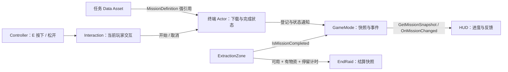

# R7 源码跟读：从下载情报到解锁撤离

这份导览接在 [R6 库存与交互指南](R6_CODE_GUIDE.md) 后面。R7 增加一个可选目标：玩家深入通讯站，长按 E 下载情报，完成后可以使用北侧撤离点。南侧路线不受任务锁限制。阅读重点是：**谁保存配置，谁执行规则，谁观察结果，以及操作中断时谁负责清理。**

本文按文件和函数名链接实际源码，方便后续小修。开发环境是本机 UE 5.8.3。源码编译、地图生成、真实运行和独立包属于不同验证层；不能由编译成功推断游戏流程或打包已经通过。

实际运行结果与证据路径见 [TEST_RESULTS_R7.md](TEST_RESULTS_R7.md)。历史基线另见 [TEST_RESULTS_R6.md](TEST_RESULTS_R6.md)。

## 1. 先认清六个角色

| 文件入口 | 负责什么 | 先读哪些符号 |
| --- | --- | --- |
| [RaidMissionDefinition.h](Source/GreyzoneRaid/RaidMissionDefinition.h) / [.cpp](Source/GreyzoneRaid/RaidMissionDefinition.cpp) | 可编辑的任务配置：ID、文案、下载时长、交互距离 | `URaidMissionDefinition`、`Validate` |
| [RaidMissionObjective.h](Source/GreyzoneRaid/RaidMissionObjective.h) / [.cpp](Source/GreyzoneRaid/RaidMissionObjective.cpp) | 场景中的通讯终端；保存当前操作者、开始时间和完成状态 | `TryBeginInteraction`、`CanInteract`、`Tick`、`CompleteInteraction`、`CancelInteraction` |
| [RaidInteractionComponent.cpp](Source/GreyzoneRaid/RaidInteractionComponent.cpp) 与 [RaidPlayerController.cpp](Source/GreyzoneRaid/RaidPlayerController.cpp) | 把 E 按下／松开送到当前玩家的交互组件；协调背包、换 Pawn 和地图输入 | `HandleInteract`、`HandleReleaseInteract`、`GetFocusedObjective`、`ReleaseInteract` |
| [RaidGameMode.h](Source/GreyzoneRaid/RaidGameMode.h) / [.cpp](Source/GreyzoneRaid/RaidGameMode.cpp) | 登记本局任务，提供统一查询和事件，在结算时保存任务结果 | `GetMissionSnapshot`、`OnMissionChanged`、`IsMissionCompleted`、`EndRaid` |
| [RaidMissionTypes.h](Source/GreyzoneRaid/RaidMissionTypes.h) 与 [RaidHUD.cpp](Source/GreyzoneRaid/RaidHUD.cpp) | 定义显示用快照；据此画进度、完成反馈、路线和战术图 | `FRaidMissionSnapshot`、`ObserveMissionMode`、`HandleMissionChanged`、`DrawMissionFeedback` |
| [RaidExtractionZone.h](Source/GreyzoneRaid/RaidExtractionZone.h) / [.cpp](Source/GreyzoneRaid/RaidExtractionZone.cpp) | 判断路线是否解锁、玩家是否真实处于触发区，并执行撤离计时 | `RequiredMissionId`、`IsAvailable`、`CountdownPlayer`、`Tick` |

任务 Actor 的私有 `bCompleted` 是运行中的完成事实。屏幕变绿、HUD 显示“完成”、北路开放，都从这个事实派生。修改一个 HUD 快照不会完成任务，也不会授予撤离资格。

## 2. 配置怎样进入场景

[URaidMissionDefinition](Source/GreyzoneRaid/RaidMissionDefinition.h) 继承 `UDataAsset`。这些字段通过 `EditAnywhere` 暴露到编辑器，地图作者可以调整，不必把每个数值写进判断分支。

| 字段 | 当前默认值／用途 |
| --- | --- |
| `MissionId` | `FrontierIntel`；用来匹配出口的任务要求 |
| `Title`、`Instruction`、`CompletedText` | 目标名称、操作说明、完成反馈 |
| `HoldSeconds` | 6 秒；校验范围为 0.1–60 秒 |
| `InteractionRange` | 260 cm；校验范围为 80–1000 cm |

`Validate` 同时检查 ID、文案和有限数值。编辑器里的 `ClampMin`／`ClampMax` 方便填写，运行时校验仍要存在。无效配置会被拒绝并记录 `R7_MISSION_CONFIG`，不会临时伪造一次任务成功。

地图生成入口是 [create_r7_map.py](Scripts/create_r7_map.py)。任务 Actor 的 `MissionDefinition` 是带 `UPROPERTY` 的资产引用；Actor 的原点放在地板上，原生碰撞盒位于原点上方，基座和屏幕提供可见终端。资产引用有助于让烘焙跟踪依赖，**仍需在独立包中验证真正加载到该 DA**。R6 曾遇到软路径目录漏 Cook 的实际问题，可对照 [R6 指南末节](R6_CODE_GUIDE.md#本轮实际遇到的-cook-问题)。

当前实现支持每局一个任务 Actor。`RegisterMissionObjective` 会拒绝第二个已注册任务，不能靠在地图里复制多台终端获得完整的多任务系统。出口的 `RequiredMissionId` 为 `None` 表示没有任务锁；北侧出口填入与 DA 相同的 `FrontierIntel`。拼错 ID 会使该出口保持锁定。

## 3. 沿着一次长按走完整条链

建议依次给下面的函数打断点，并观察 `ActivePlayer`、`InteractionStartedAt` 和 `bCompleted`。

1. [Controller 的 `SetupInputComponent`](Source/GreyzoneRaid/RaidPlayerController.cpp) 为同一个 `Interact` Action 绑定 `IE_Pressed` 和 `IE_Released`。按下走 `HandleInteract`；松开走 `HandleReleaseInteract`。
2. [Interaction 的 `Interact`](Source/GreyzoneRaid/RaidInteractionComponent.cpp) 保留原来的“面板已打开就关闭”行为。没有面板时，先找聚焦的任务终端，再走原来的容器入口。
3. `GetFocusedObjective` 取得本局任务，调用 [Actor 的 `CanInteract`](Source/GreyzoneRaid/RaidMissionObjective.cpp)。这里检查 Running、当前 Pawn 能行动、背包关闭、任务未完成；再从玩家相机沿视线做 `ECC_Visibility` 射线，要求在配置距离内真正命中这个终端。站得近但背对终端，或隔墙看终端，都不满足条件。
4. `TryBeginInteraction` 再次校验，记录当前玩家和开始时刻，绑定受伤通知，启用任务 Actor 的 Tick，并通知 GameMode。它会停下当时的开火、瞄准和换弹，但不把游戏暂停，也不切换成库存鼠标模式。
5. `GetSnapshot` 用世界时间计算 `Progress = clamp((当前时间 - 开始时间) / HoldSeconds, 0, 1)`。进度依赖实际经过的游戏时间，不依赖跑了多少帧；长按途中改变帧率不应缩短所需时间。
6. `Tick` 持续复核玩家、距离、视线和伤害。达到时长后，`CompleteInteraction` 再检查一次条件，然后先结束绑定与计时，再把私有 `bCompleted` 设为真，发出完成通知。出口下次查询时即可看到解锁结果。

这里维护的是“按下开始、松开结束”的输入语义，没有用 HUD 每帧检查物理键盘。验证导演可以执行真实绑定的输入委托来检查路由，但这种自动化结果应写作**输入委托验证**，不能称为手工硬件键盘实测。

## 4. 为什么取消和退出清理同样重要

下载中途失败会归零。玩家重新靠近并按下 E 才能开始新一轮，不会自动恢复残留进度。重点看 [CancelInteraction / EndPlay](Source/GreyzoneRaid/RaidMissionObjective.cpp) 和 [Interaction 的 Close / Cleanup](Source/GreyzoneRaid/RaidInteractionComponent.cpp)。

| 发生什么 | 代码怎样结束下载 |
| --- | --- |
| 松开 E | Controller 转发 `ReleaseInteract`，组件让当前终端取消并清空自己的弱引用 |
| 看向别处、走出距离或失去视线 | Actor 下一次 Tick 的 `CanInteract` 失败，取消下载 |
| 受到伤害 | `OnTakeAnyDamage` 同步调用 `HandlePlayerDamage`；取消不必等下一帧；Tick 还会比较 `LastDamageTime` |
| 打开背包／关闭交互会话 | `ToggleInventory`／`Close` 先调用 `ReleaseInteract`；原有容器清理继续执行 |
| 玩家失去控制或被替换 | Controller 释放旧 Pawn 时进入既有清理链；`Player::CanAct` 也要求 Controller 当前确实控制该 Pawn |
| 死亡或行动结束 | GameMode 关闭玩家交互；任务 Tick 也要求对局仍在 Running |
| 终端被销毁或切换关卡 | Actor 的 `EndPlay` 解绑受伤通知、清掉操作者和开始时间，并向 GameMode 注销 |

`TWeakObjectPtr` 表示“引用不会让对象继续存活”，不表示“业务已经结束”。因此 `CancelInteraction` 还要移除 `OnTakeAnyDamage` 委托、清空开始时刻、停用 Tick，再通知界面。仅把指针设空，会留下需要另外解释的计时和事件状态。

`EndRaid` 先复制 [任务快照](Source/GreyzoneRaid/RaidGameMode.cpp)，把 `bInProgress` 关闭，进度固定为完成的 1 或未完成的 0，再进入结算。之后玩家交互的清理不会抹掉已经完成的任务结果。重新开始使用原有 `OpenLevel` 流程创建新世界，任务状态随新 Actor 重置。

## 5. HUD 观察状态，出口执行规则

[FRaidMissionSnapshot](Source/GreyzoneRaid/RaidMissionTypes.h) 是按值返回的显示数据，包含 `bPresent`、`bInProgress`、`bCompleted`、任务 ID、文案、世界位置、归一化进度和时长。外部即使修改自己的副本，也不会修改终端状态。`BlueprintReadOnly` 限制蓝图写入；真正的 C++ 状态隔离来自 Actor 私有字段和没有授予完成权限的查询接口。

[GameMode 的 `GetMissionObjective`](Source/GreyzoneRaid/RaidGameMode.cpp) 优先读取已登记的 Actor；若 `BeginPlay` 还未派发到终端，会只读查找已放置且配置有效的任务。这避免 HUD 初始化顺序不同，就误把 Frontier 当成没有任务的场景。

[HUD 的 `ObserveMissionMode`](Source/GreyzoneRaid/RaidHUD.cpp) 先读一次快照，再绑定 `OnMissionChanged`；换观察对象时移除旧委托。开始、取消和完成等状态变化触发事件。下载过程中，`DrawHUD` 读取随世界时间变化的进度，不要求任务每帧广播一次事件。`HandleMissionChanged` 比较前后状态，记录完成／中断反馈的显示时刻。

M 战术图仍通过 Controller 路由到 HUD。`ToggleTacticalMap` 要求对局 Running、玩家可行动、存在任务、库存关闭。地图不暂停战斗或改变输入模式；Esc 优先关闭战术图，Tab 先关闭地图再执行背包操作。相关入口是 [HandleToggleTacticalMap / HandleBack](Source/GreyzoneRaid/RaidPlayerController.cpp)。

出口的 [IsAvailable](Source/GreyzoneRaid/RaidExtractionZone.cpp) 只回答**任务锁是否解除**。它不保证玩家已有物资、站在触发区或已经等够时间。`Tick` 仍会检查真实重叠、玩家行动状态、携带数量和伤害时间；只有满足全部条件并完成倒计时，才调用 `EndRaid(true)`。HUD 可以提示出口开放，不能代替这些判定。

## 6. 撤离时间为什么要绑定 Pawn 身份

设玩家 A 已在撤离区等了 6 秒，此时控制器切换到同样位于区域内、也带有物资的玩家 B。仅检查“现在有人在区内”，B 就可能继承 A 剩余的 2 秒。

[ExtractionZone 的 `CountdownPlayer`](Source/GreyzoneRaid/RaidExtractionZone.h) 记录倒计时对应的 Pawn。每次 Tick 先比较当前玩家身份：发生变化，就把剩余时间恢复到 `ExtractSeconds`，清掉运行标记，并更新伤害时间基线。即使 A 和 B 的切换发生在同一帧，只要该次 Tick 观察到 B，也不需要先经过“无玩家的一帧”才重置。

某帧没有玩家，或玩家 `CanAct` 为假时，也会重置未结束的撤离。这样同一 Pawn 在失去控制一段时间后重新被控制，不能继续旧进度。离开触发区、没有物资、出口仍锁定和受到伤害的原有重置路径也保留。

有一个有意保留的结果语义：**正常成功结算且 Pawn 未更换时，剩余时间保持 0**。这让结算显示与原有 [RaidTestDirector](Source/GreyzoneRaid/RaidTestDirector.cpp) 的成功断言仍能读取“计时已完成”。身份变化检查在此之前执行；结算后再换 Pawn 或解除控制，仍可能把计时重置为完整时长。

## 7. 与 R6 的边界，以及怎么继续学

第一人称手部另见 [R7_HANDS_NOTES.md](R7_HANDS_NOTES.md)。初学时先区分真实换弹与视觉回位：`CancelReload` 清除补弹计时器，`UpdateWeaponPresentation` 继续短暂移动手和弹匣，但不会调用 `FinishReload` 发放弹药。`RaidArmsAnimInstance` 在游戏线程读取角色提供的进度，动画求值只采样资源；`author_r7_hands.py` 则是编辑器工具，负责根据接触位置求解肩肘腕，不在普通游戏启动时运行。

Depot 没有有效任务 Actor，`GetMissionSnapshot().bPresent` 为假；默认出口的 `RequiredMissionId=None`、ID 为 E-07、时长仍为 8 秒。HUD 保留原有无任务分支，R6 的库存 Model、条目身份、revision 和四项物品目录继续使用。新增任务没有往 `DA_RaidItems` 塞第五种物品，也没有把情报下载伪装成一次背包转移。

这版仍是单人玩法。下载完成是本局状态，结算中可以显示是否完成；没有任务赏金入账、跨局仓库、持久经济、联机复制或通用多阶段任务编排。下一局重新生成任务，不从上局快照恢复。

本机引擎源码只需核对两个点，不必先读完整引擎：

- `Engine/Source/Runtime/Engine/Private/Actor.cpp` 的 `AActor::BeginPlay`／Tick 注册主线，对照终端先禁用 Tick、下载开始时启用、结束时禁用的顺序。
- `Engine/Source/Runtime/CoreUObject/Public/UObject/ConstructorHelpers.h` 的 `FObjectFinderOptional`，对照终端如何引用项目已有材质。当前调用已通过本机 UE 5.8.3 编译；换引擎版本仍需重新核对。

这些局部事实解释 API 和生命周期用法，不构成 FPS 或独立包可运行的证据。运行入口和断言实现可读 [RaidR7TestDirector.cpp](Source/GreyzoneRaid/RaidR7TestDirector.cpp)；实际哪些用例已经通过，应查 [R7 测试结果](TEST_RESULTS_R7.md)。

下面五个练习可以结合断点或手工记录完成。先预测状态，再对照代码；修改实验请使用自己确认可回退的副本。

| 练习／面试问题 | 应能解释的答案与验证点 |
| --- | --- |
| 1. 把下载时间改成 3 秒，要改哪一层？ | 修改任务 DA 的 `HoldSeconds`，让 `Validate` 接受；Actor 和 HUD 都读取同一个配置。检查 30 FPS 与 60 FPS 时，进度是否都按世界时间推进。不能只改 HUD 的“6 秒”文字。 |
| 2. 下载到 80% 时松开 E，然后再按下，会从哪里开始？ | `ReleaseInteract → CancelInteraction` 清掉开始时刻与操作者，再次按下产生新开始时间，所以从 0 开始。观察完成事件不能在第一次松开后继续出现。 |
| 3. 为什么已经检查 Tick，还要绑定受伤事件？ | 受伤事件使中断在伤害处理时发生；Tick 和完成前复查提供持续条件校验。沿 `HandlePlayerDamage` 确认它只取消当前操作者的下载，并会解绑。 |
| 4. HUD 把快照里的 `bCompleted` 改成 true，北路会开放吗？ | 不会。那只是副本；出口通过 GameMode 查询终端的实际完成状态。进一步解释 `BlueprintReadOnly` 与 C++ 私有状态各保护什么。 |
| 5. A 已等 6 秒，换成 B 后为什么必须再等？ | `CountdownPlayer` 检查对象身份，B 无法继承 A 的时间。对照无 Pawn、同 Pawn 隔帧重新控制、换成另一 Pawn 三种路径，并解释正常成功结算且未换 Pawn 时为什么保留 0 秒。 |

